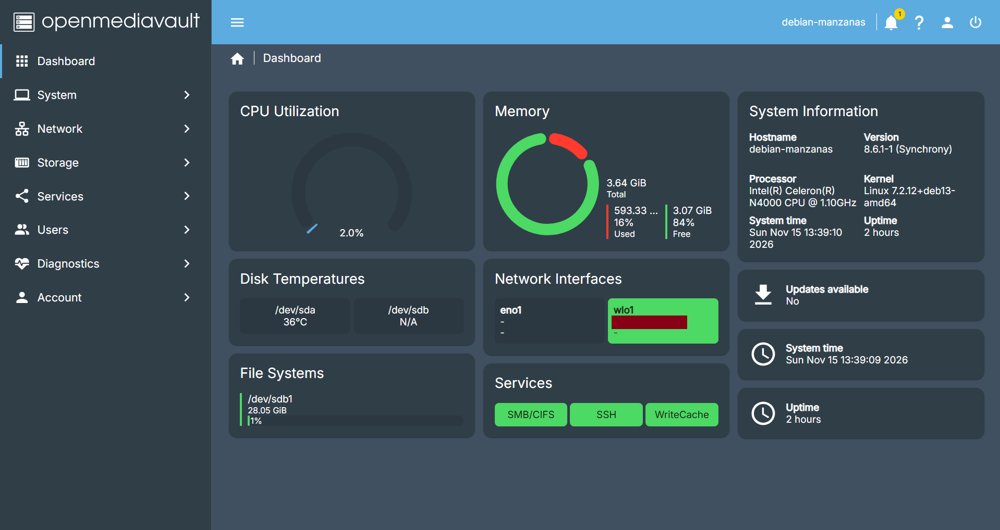
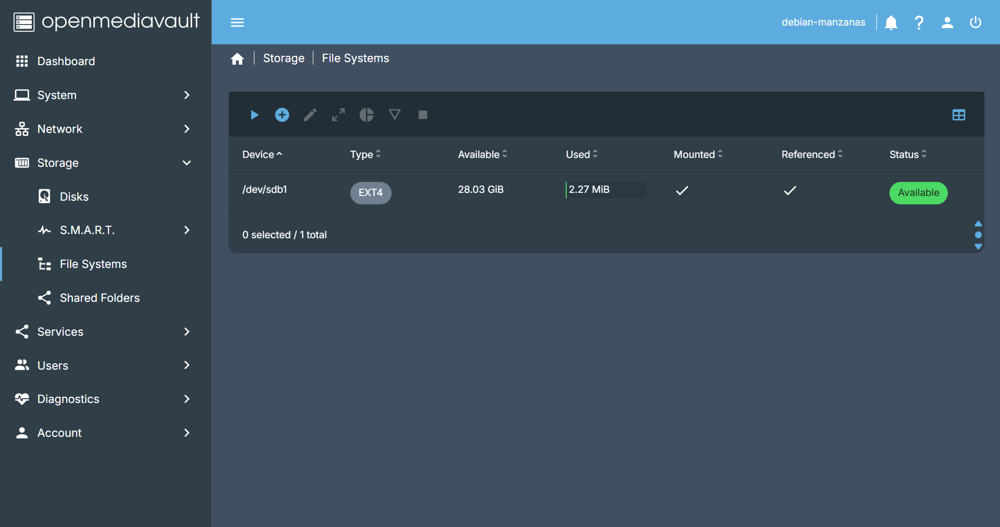
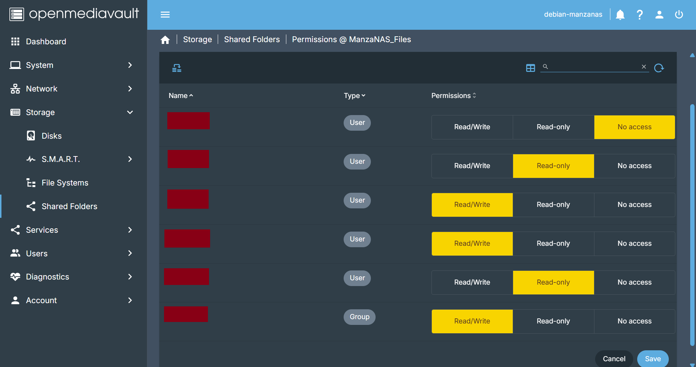
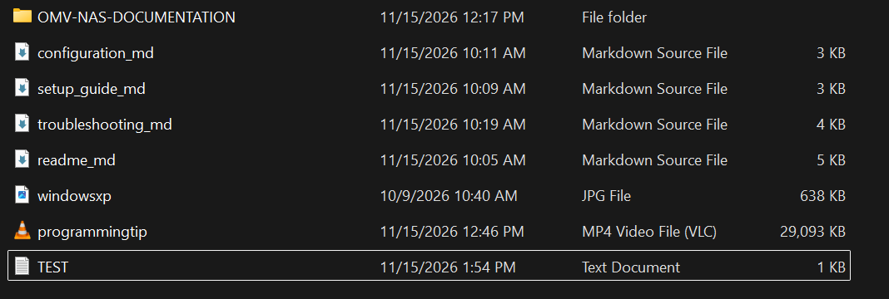
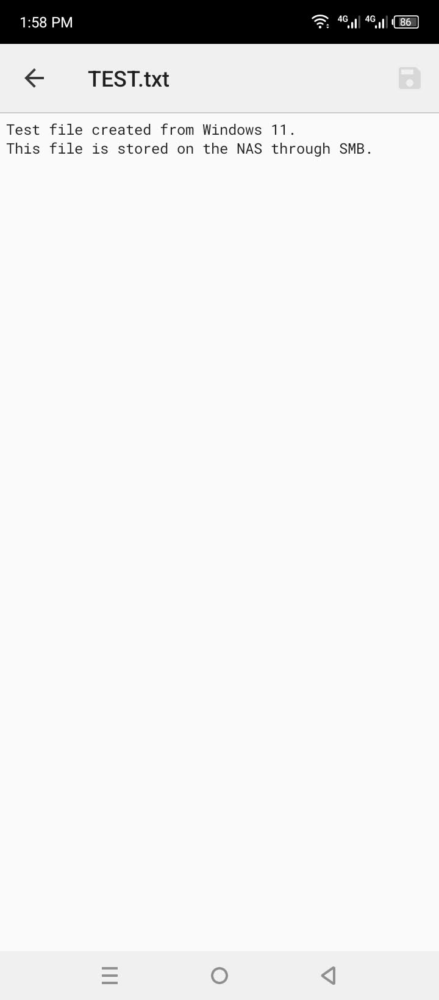

# ManzaNAS — OpenMediaVault NAS HomeLab

A personal Network Attached Storage (NAS) HomeLab built using Debian Linux and OpenMediaVault on repurposed laptop hardware.

This project explores basic server administration, network file sharing, user access management, network interface configuration, and cross-device file access within a local network.

## 1. Project Overview

ManzaNAS is a self-hosted NAS built using an old HP laptop running a foundational Debian Linux OS with OpenMediaVault (OMV) installed on top.

The goal was to repurpose available hardware into a centralized, headless file-sharing system that allows multiple devices to access shared files through the local Wi-Fi network, ensuring continuous uptime and a permanent static IP address.

The project was developed as a hands-on learning experience in IT infrastructure, system administration, networking, and Linux command-line troubleshooting.

## 2. Project Objectives

- Deploy Debian Linux and OpenMediaVault on repurposed laptop hardware.
- Configure network-based file sharing using SMB/CIFS.
- Establish a permanent static Wi-Fi connection (`wlo1`) for a headless server environment.
- Create shared folders and manage user permissions.
- Connect Windows and Android devices to the NAS.
- Practice basic server configuration and CLI troubleshooting (`ip` suite, `omv-firstaid`).
- Document the implementation and network architecture.

## 3. Hardware Specifications

| Component | Specification |
|---|---|
| Server | Repurposed HP Laptop |
| CPU | Intel Celeron N4000 @ 1.10 GHz |
| CPU Cores | 2 |
| Memory | 4 GB RAM |
| Storage | 500 GB HDD |
| Hostname | ManzaNAS |
| Interfaces | `eno1` (Gigabit Ethernet), `wlo1` (Wi-Fi) |

## 4. Technologies and Tools

- **Operating System:** Debian Linux (Base) / OpenMediaVault (GUI)
- **File Sharing Protocol:** SMB/CIFS
- **Networking:** TCP/IP, Local Area Network (LAN), static IP binding
- **Windows Client:** Windows 11
- **Android Client:** CX File Explorer
- **Documentation:** GitHub and Markdown

## 5. Implemented Features

- OpenMediaVault installation and network configuration.
- SMB/CIFS network file sharing.
- Shared folder configuration (`ManzaNAS_LJ`).
- Separate user accounts and access permissions (`lj814` for OS, `manza` for SMB).
- Power management adjustments to prevent the laptop from sleeping.
- Network-based access to shared storage.

## 6. Network Architecture

The NAS operates within a local network and provides shared storage access to connected client devices via a permanent static Wi-Fi connection.

*(Note: Add your `network-diagram.png` to the `docs/` folder)*

## 7. Screenshots

*(Note: Upload your screenshots to the `screenshots/` folder in your repository to display them here)*

### OpenMediaVault Dashboard

### Storage and Shared Folders

### SMB Configuration

### User Permission Management

### Client Access
**Windows 11**

**Android**

## 8. Documentation

- [Setup Guide](setup-guide.md)
- [Configuration Details](configuration.md)
- [Troubleshooting](troubleshooting.md)

## 9. Project Limitations

The current implementation has the following limitations:

- Remote access (outside the local LAN) is not implemented.
- Automated backup is not implemented.
- The system uses repurposed laptop hardware with a single HDD, meaning no RAID redundancy.
- Relies on Wi-Fi (`wlo1`) as the primary connection, which requires specific power management handling.

## 10. Learning Outcomes

Through this project, I gained hands-on experience with:

- Installing and configuring a Linux-based NAS operating system.
- Troubleshooting Linux network interfaces using `omv-firstaid` and `ip` commands.
- Bypassing hardware bugs (e.g., HP Wi-Fi Warm Boot issues) through cold booting and power state masking.
- Understanding SMB/CIFS network file sharing and user permissions.
- Technical documentation preparation.

## 11. Future Improvements

Potential improvements include:

- Implementing an automated backup strategy.
- Exploring secure remote access.
- Monitoring system resources and storage health.

---

**Project Name:** ManzaNAS  
**Project Type:** Personal IT HomeLab  
**Purpose:** Hands-on learning in system administration, networking, and IT infrastructure.
