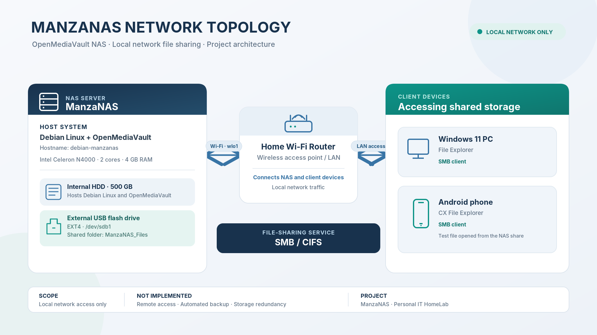
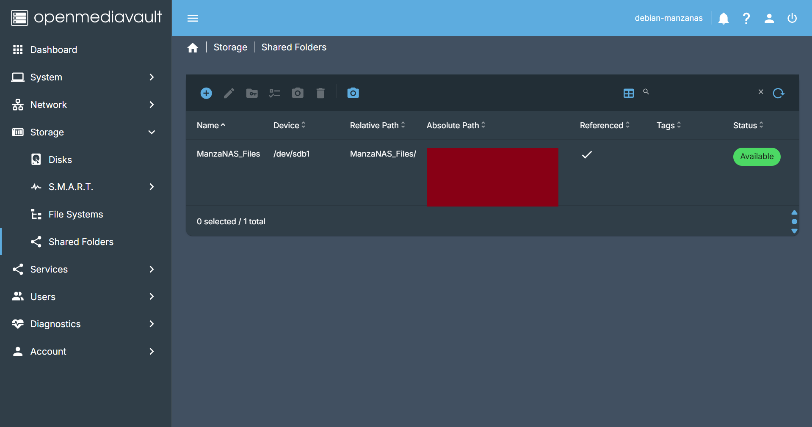
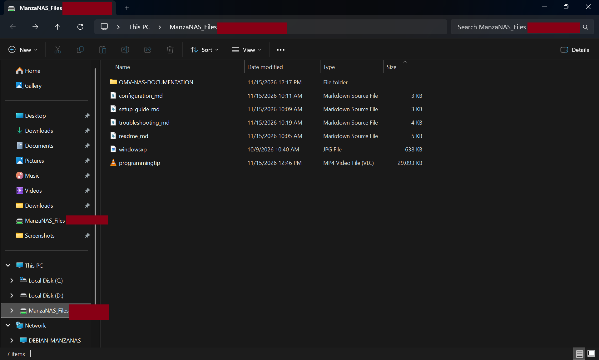
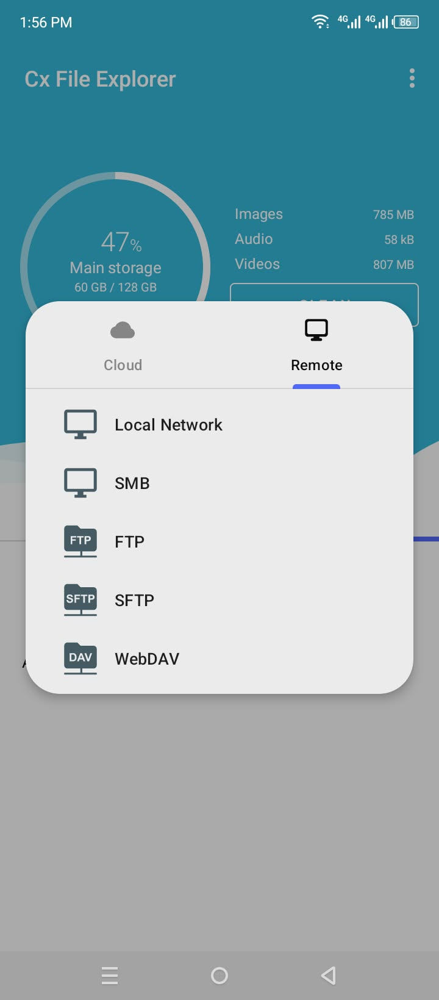
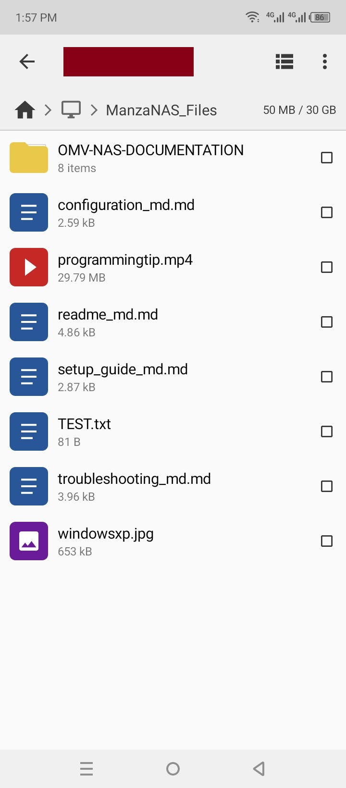

# ManzaNAS — OpenMediaVault NAS HomeLab

A personal Network Attached Storage (NAS) HomeLab built using Debian Linux and OpenMediaVault on repurposed laptop hardware.

This project explores basic server administration, network file sharing, user access management, network interface configuration, and cross-device file access within a local network.

## 1. Project Overview

ManzaNAS is a self-hosted NAS built using a repurposed HP laptop running Debian Linux with OpenMediaVault (OMV) installed as its web-based management interface.

The goal was to repurpose available hardware into a centralized, headless file-sharing system that allows multiple devices to access shared files through the local Wi-Fi network.

The project was developed as a hands-on learning experience in IT infrastructure, system administration, networking, and Linux command-line troubleshooting.

## 2. Project Objectives

- Deploy Debian Linux and OpenMediaVault on repurposed laptop hardware.
- Configure network-based file sharing using SMB/CIFS.
- Configure the Wi-Fi network interface (`wlo1`) for easy access into local network access.
- Create shared folders and manage user permissions.
- Connect Windows and Android devices to the NAS.
- Practice basic server configuration and command-line troubleshooting using the `ip` utility and `omv-firstaid`.
- Document the implementation and network architecture.

## 3. Hardware Specifications

| Component | Specification |
|---|---|
| Server | Repurposed HP laptop |
| CPU | Intel Celeron N4000 @ 1.10 GHz |
| CPU Cores | 2 |
| Memory | 4 GB RAM |
| Internal Storage | 500 GB HDD (system drive) |
| Additional Storage | External USB flash drive (shared data storage) |
| Data Filesystem | EXT4 |
| Hostname | debian-manzanas |
| Network Interfaces | `eno1` (Ethernet), `wlo1` (Wi-Fi) |

The internal HDD hosts the operating system, while the external USB flash drive is used for the shared data filesystem.

## 4. Technologies and Tools

- **Operating System:** Debian Linux
- **NAS Management:** OpenMediaVault
- **File Sharing Protocol:** SMB/CIFS
- **Filesystem:** EXT4
- **Networking:** TCP/IP and Local Area Network (LAN)
- **Network Interface Configuration:** Linux `ip` utility and OpenMediaVault
- **Windows Client:** Windows 11
- **Android Client:** CX File Explorer
- **Documentation:** GitHub and Markdown

## 5. Implemented Features

- Installed and configured Debian Linux and OpenMediaVault.
- Configured SMB/CIFS network file sharing.
- Created and configured the `ManzaNAS_Files` shared folder.
- Configured separate user accounts and folder access permissions.
- Configured Wi-Fi connectivity for local network access.
- Adjusted laptop power management settings to reduce automatic sleep or suspension during operation.
- Enabled shared file access from Windows 11 and Android devices.
- Tested cross-device file access using a sample text file.

## 6. Network Architecture

ManzaNAS operates within a local network and provides shared storage access to connected client devices through its Wi-Fi interface.

The network interface `wlo1` is used for the NAS's wireless network connection.

## 7. Screenshots

*(Note: Upload your screenshots to the `screenshots/` folder in your repository to display them here)*

### OpenMediaVault Dashboard

### Storage and Shared Folders

### SMB Configuration

### User Permission Management

### Client Access
**Windows 11**

**Android**

  

  

  

### Cross-Device File Sharing Test

A sample text file was created from Windows 11, stored on the NAS through SMB, and subsequently accessed from an Android device.

## 8. Project Documentation

- [Setup Guide](docs/setup-guide.md)
- [Configuration Details](docs/configuration.md)
- [Troubleshooting](docs/troubleshooting.md)

## 9. Project Limitations

The current implementation has the following limitations:

- Remote access outside the local network is not implemented.
- Automated backup is not implemented.
- The shared data storage uses a single external USB flash drive without storage redundancy.
- The system relies primarily on Wi-Fi connectivity.
- The project uses repurposed laptop hardware with limited system resources.

## 10. Learning Outcomes

Through this project, I gained hands-on experience with:

- Installing and configuring a Debian-based NAS environment.
- Managing a Linux-based server through a web administration interface.
- Configuring network interfaces and troubleshooting connectivity.
- Using Linux command-line utilities such as `ip` and `omv-firstaid`.
- Understanding SMB/CIFS file sharing and user access permissions.
- Connecting Windows and Android clients to network storage.
- Performing basic system and network troubleshooting.
- Preparing technical documentation and network diagrams.

## 11. Future Improvements

Potential improvements include:

- Implementing an automated backup and recovery strategy.
- Replacing the USB flash drive with dedicated HDD or SSD storage.
- Exploring secure remote access.
- Monitoring system resources and storage health.
- Improving network reliability through a wired Ethernet connection.

---

**Project Name:** ManzaNAS  
**Project Type:** Personal IT HomeLab  
**Purpose:** Hands-on learning in system administration, networking, and IT infrastructure.

